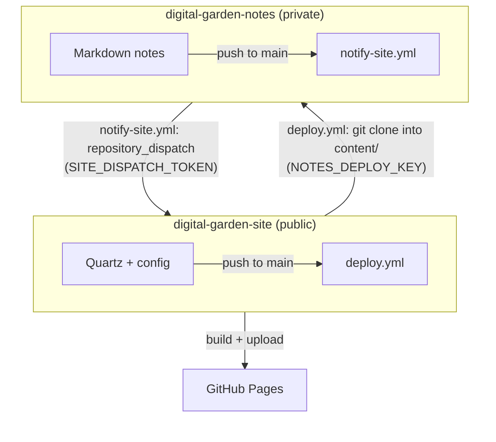

# Digital Garden

Personal digital garden published at **https://cahersan.github.io/digital-garden-site/**.

The site is built with [Quartz v4](https://quartz.jzhao.xyz/) by [jackyzha0](https://github.com/jackyzha0/quartz). This repo is a copy of Quartz plus the configuration and deployment pipeline for this site; the notes themselves live in a separate private repo.

## Two-repo structure

| Repo | Visibility | Local path | Holds |
|---|---|---|---|
| [`digital-garden-site`](https://github.com/Cahersan/digital-garden-site) | public | `~/Digital Garden/site` | Quartz, site configuration and styling, deploy workflow |
| `digital-garden-notes` | private | `~/Digital Garden/notes` | Markdown notes, tag registry (`tags.md`), note tooling, rebuild trigger workflow |

Keeping them apart means the notes stay private while the site code is public, each repo has its own history, and work on the site (configuration, styling) is separate from work on the notes (writing, linting, reorganizing). Each repo has its own `CLAUDE.md`, so a Claude Code session started in one folder only gets the context for that concern.



### What gets published

Quartz builds every Markdown file in `content/`, then the built-in `ExplicitPublish` filter keeps only notes whose frontmatter has `publish: true`. Files without frontmatter (`tags.md`, `CLAUDE.md`, `README.md` in the notes repo) are skipped automatically. `notes/index.md` is the home page.

Non-Markdown files (images, PDFs...) placed in the notes repo are copied to the site by Quartz's `Assets` emitter **regardless of `publish`**. Dot-folders (`.github`, `.obsidian`, `.tools`) are never published.

## Local development

Requires Node 22+ and npm 10.9.2+ (installed via [nvm](https://github.com/nvm-sh/nvm): `nvm install 22`).

```bash
cd ~/"Digital Garden"/site
npm ci
npx quartz build            # output in public/
npx quartz build --serve    # local preview at http://localhost:8080
```

Locally, `content` is a symlink to the notes repo:

```bash
ln -s ../notes content
echo '/content' >> .git/info/exclude
```

The symlink is excluded through `.git/info/exclude` and **not** `.gitignore`, because Quartz skips every file matched by `.gitignore`, which would hide all the notes from the build. In CI, `content/` is a fresh clone of the notes repo instead.

## Deployment pipeline

1. A push to `main` in the notes repo runs `notify-site.yml`, which calls the GitHub API to send a `repository_dispatch` event (`notes-updated`) to this repo.
2. That event, a push to `main` in this repo, or a manual run triggers `deploy.yml`.
3. `deploy.yml` clones the notes repo into `content/` using a read-only deploy key, builds Quartz and publishes `public/` to GitHub Pages.

### Workflow files

| File | Repo | Purpose |
|---|---|---|
| `.github/workflows/deploy.yml` | site | Build and deploy the site |
| `.github/workflows/notify-site.yml` | notes | Trigger a site rebuild on every notes push |
| `.github/dependabot.yml` | site | Weekly PR bumping the action versions used in `deploy.yml` |

**`deploy.yml`**

- Triggers: `push` to `main`, `repository_dispatch` of type `notes-updated`, `workflow_dispatch` (the *Run workflow* button in the Actions tab).
- Permissions: `contents: read`, `pages: write`, `id-token: write`. Runs are serialized in the `pages` concurrency group.
- `build` job: `actions/checkout`, `webfactory/ssh-agent` (loads `NOTES_DEPLOY_KEY`), `git clone --depth 1` of the notes repo into `content`, `actions/setup-node` (Node 22), `npm ci`, `npx quartz build`, `actions/configure-pages`, `actions/upload-pages-artifact` (`public/`).
- `deploy` job: `actions/deploy-pages`, in the `github-pages` environment.

**`notify-site.yml`**: a single `curl` to `POST /repos/Cahersan/digital-garden-site/dispatches` authenticated with `SITE_DISPATCH_TOKEN`. It fails visibly (`--fail-with-body`) if the token is invalid or expired.

**`dependabot.yml`**: only covers `github-actions`. npm dependencies are deliberately left out: `package.json` and `package-lock.json` belong to Quartz, and bumping them here would conflict with upstream updates (see [Maintenance](#maintenance)).

## GitHub configuration

### Pages

Site repo → **Settings → Pages → Build and deployment → Source: GitHub Actions**.

`baseUrl` in `quartz.config.ts` must match the Pages URL without protocol: `cahersan.github.io/digital-garden-site`.

### Secrets and keys

No secret values are stored in either repo; only these names are referenced.

| Name | What it is | Where it lives | Access |
|---|---|---|---|
| `NOTES_DEPLOY_KEY` | Private half of an ed25519 SSH key, no passphrase | Site repo → Settings → Secrets and variables → Actions | Used by `deploy.yml` to clone the notes repo |
| *(deploy key)* | Public half of the same key | Notes repo → Settings → Deploy keys | Read-only ("Allow write access" unchecked) |
| `SITE_DISPATCH_TOKEN` | Fine-grained personal access token | Notes repo → Settings → Secrets and variables → Actions | Repository access: only `digital-garden-site`; permission Contents: read and write (required by the dispatch API). Expires. |

The fine-grained token is created at GitHub → profile picture → **Settings → Developer settings → Personal access tokens → Fine-grained tokens**.

## Maintenance

### Renewing the dispatch token

When `SITE_DISPATCH_TOKEN` expires, notes pushes stop triggering rebuilds (the *Notify site* workflow fails with 401). Create a new fine-grained token with the same settings and replace the secret value in the notes repo. Nothing else changes.

### Rotating the deploy key

```bash
ssh-keygen -t ed25519 -C "digital-garden-site deploy" -f ~/.ssh/digital-garden-notes-deploy -N ""
```

Replace the public key under the notes repo's Deploy keys (delete the old one) and paste the whole private key file, from `-----BEGIN` to `-----END OPENSSH PRIVATE KEY-----`, into `NOTES_DEPLOY_KEY`. Never use a personal SSH key for this.

### Updating Quartz and its dependencies

npm dependencies are pinned by `package-lock.json` and only change when Quartz itself is updated. The `upstream` remote points at `https://github.com/jackyzha0/quartz.git`, branch `v4`.

```bash
npx quartz update     # pulls upstream v4 and runs npm i
```

or by hand:

```bash
git fetch upstream
git merge upstream/v4
npm ci
```

`npx quartz update` merges with `-X ours`, so on conflicting lines our version silently wins and an upstream fix can be missed. Keep customizations in the files listed below to make conflicts rare. Build locally before pushing. To be notified of new releases, watch the Quartz repo (Watch → Custom → Releases).

## Customization

Changes made to this repo relative to upstream Quartz:

| File | Change |
|---|---|
| `quartz.config.ts` | `pageTitle`, `baseUrl`, `ExplicitPublish` added to `filters` |
| `.github/workflows/` | Quartz's own workflows (`ci`, `build-preview`, `deploy-preview`, `docker-build-push`) removed; `deploy.yml` added |
| `.github/dependabot.yml` | npm updates removed, only `github-actions` kept |
| `content/.gitkeep` | Removed; `content` is a local symlink or a CI clone |
| `README.md` | This file |

Where future customizations go:

- `quartz.config.ts`: site settings, theme colors and fonts, plugins.
- `quartz.layout.ts`: page layout and components (explorer, graph, backlinks, table of contents).
- `quartz/styles/custom.scss`: custom CSS.

Add each change to the table above.
